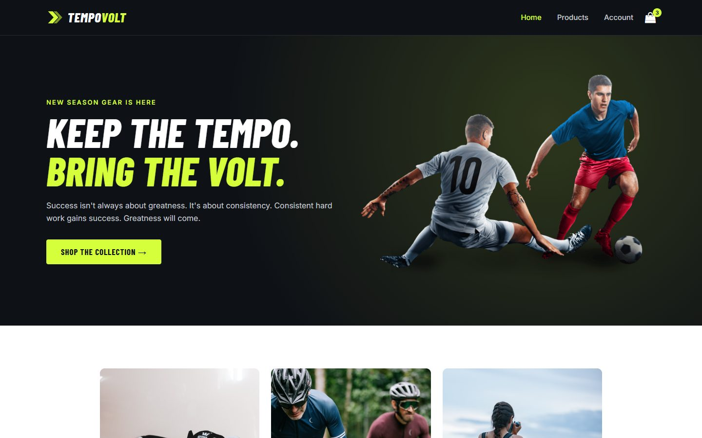
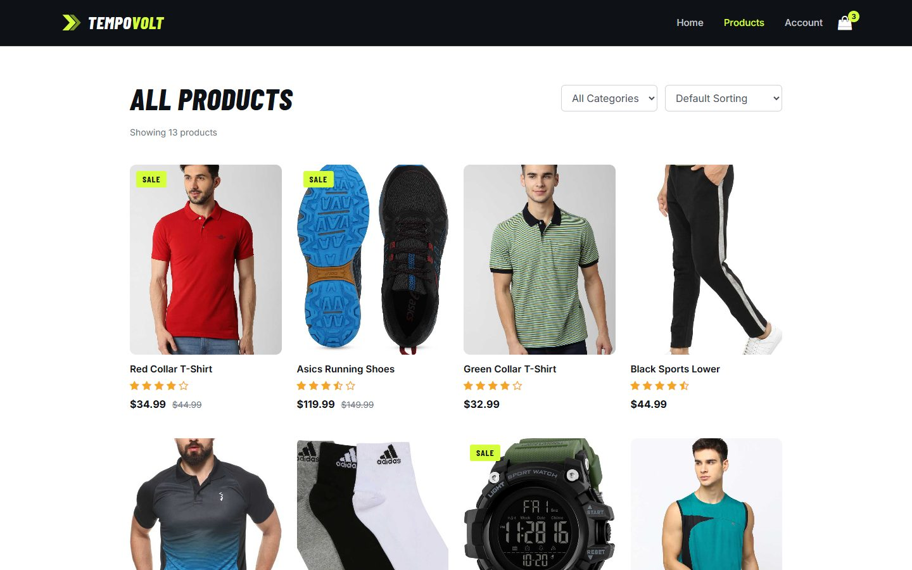
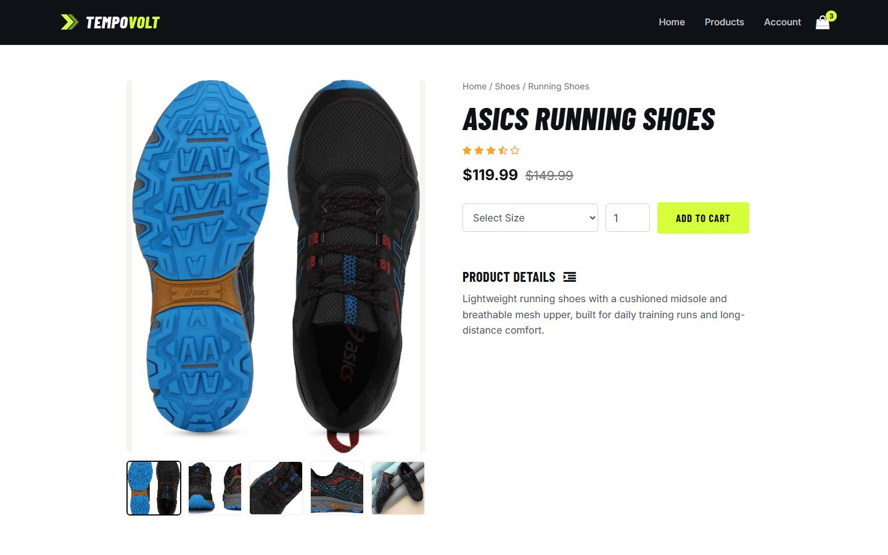
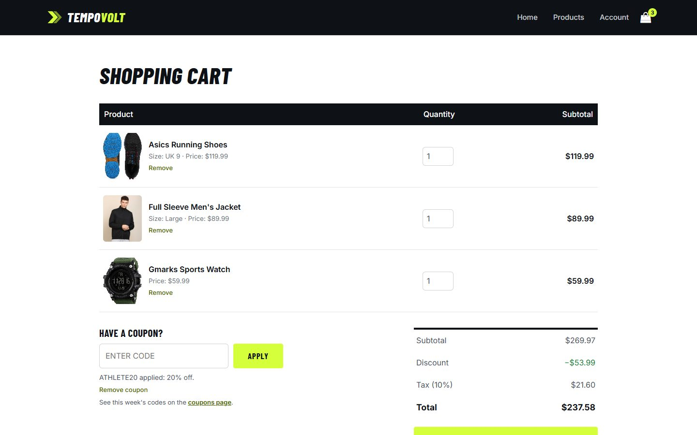
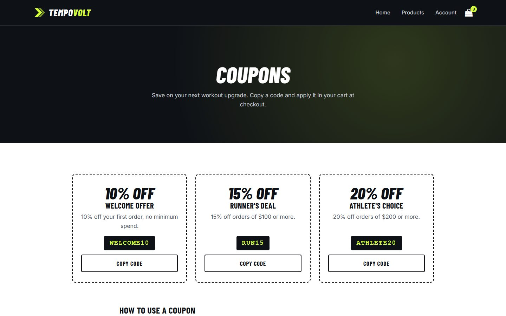
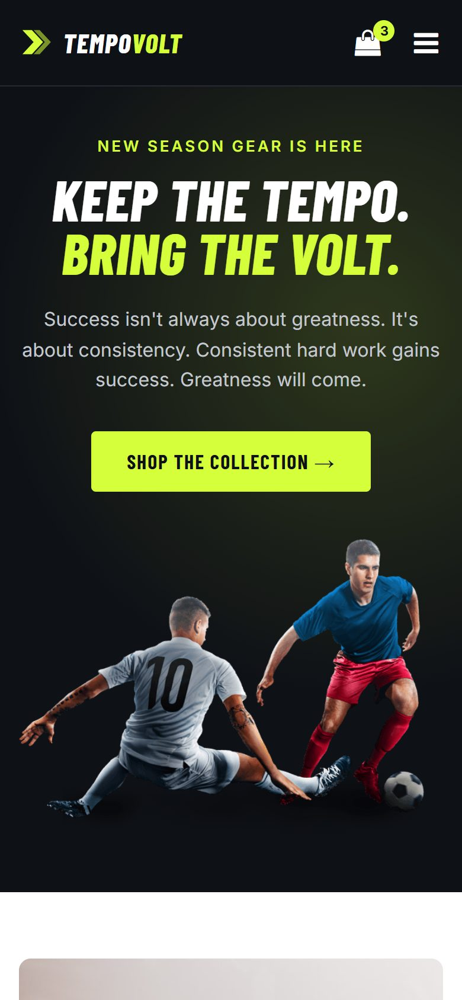
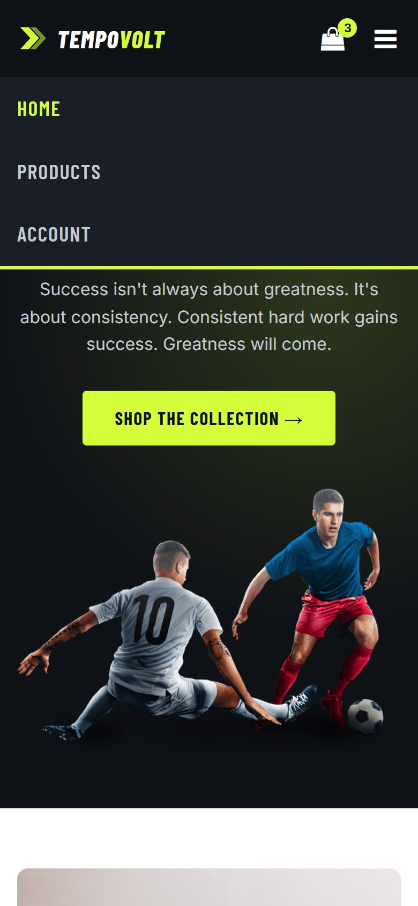
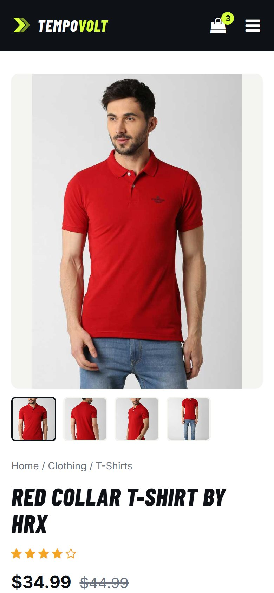
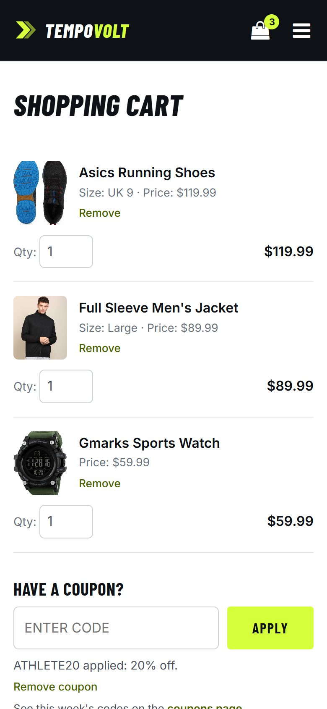
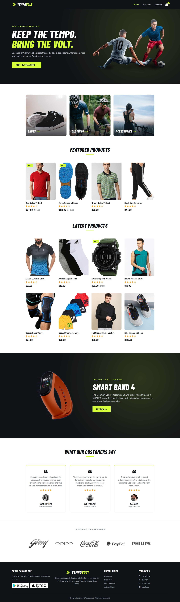

<div align="center">

# ⚡ Tempovolt

**Keep the tempo. Bring the volt.**

A responsive e-commerce storefront for performance sportswear, running shoes and training gear,<br />
built from scratch with plain **HTML, CSS and JavaScript**: no frameworks, no build step, no dependencies.

[**Live Demo**](https://tempovolt.vercel.app) · [Features](#-features) · [Screenshots](#-screenshots) · [Getting Started](#-getting-started)




</div>

---

## 📸 Screenshots

### Desktop

| Products (filter + sort) | Product details |
| :---: | :---: |
|  |  |
| **Cart with a coupon applied** | **Coupons** |
|  |  |

### Mobile

| Home | Navigation | Product | Cart |
| :---: | :---: | :---: | :---: |
|  |  |  |  |

<details>
<summary><b>View the full home page</b></summary>
<br />

</details>

---

## ✨ Features

### Shopping
- 🛒 **Working cart:** add items with size and quantity, edit quantities, remove items. The cart persists in `localStorage` and stays in sync across browser tabs.
- 🏷️ **Coupon codes:** percentage discounts with minimum-spend rules, validated in the cart. Tax is calculated after the discount.
- ✅ **Demo checkout:** places a simulated order with a confirmation number.
- 🔎 **Filter and sort:** browse by category and sort by price, rating or name. Filters can be linked to directly, for example `products.html?category=Shoes`.
- 🖼️ **Product pages:** image gallery, sale pricing, sizes that fit each product type (clothing, UK shoe sizes, none for watches) and related products.

### Design and UX
- 📱 **Fully responsive:** mobile-first layout built with CSS Grid and Flexbox and fluid typography. Tested from 320px phones to 1440px desktops with no horizontal scrolling.
- 🎨 **Custom brand identity:** an SVG logo mark, favicon and app icon, plus a design-token system (colour, type and spacing) in one place.
- 📐 **Consistent layout:** a shared spacing scale, a sticky header and a footer that always sits at the bottom of the page.
- 💳 **Cart on mobile:** the cart table turns into stacked cards on small screens.

### Quality
- ♿ **Accessible:**
  - semantic landmarks and a skip link
  - labelled form fields and real `<button>` elements
  - visible focus styles
  - screen-reader text for star ratings and sale prices
  - `aria-expanded` and Escape-to-close on the mobile menu
  - support for the `prefers-reduced-motion` setting
- 🚀 **Performant:** lazy-loaded images with explicit dimensions (no layout shift), deferred JavaScript, and Font Awesome pinned with an integrity (SRI) hash.
- 🔍 **SEO-ready:** unique titles and meta descriptions, Open Graph tags, and schema.org `Product` data on every product page.
- 🛡️ **Safe DOM updates:** cart rows are built with `textContent` and `createElement` instead of `innerHTML`, and stored data is validated before use.

---

## 🧰 Tech Stack

| Layer | Choice |
| --- | --- |
| Markup | Semantic HTML5 |
| Styling | CSS3: custom properties, Grid, Flexbox, `clamp()` |
| Behaviour | Vanilla JavaScript (ES2020), `localStorage`, `Intl.NumberFormat` |
| Fonts | [Barlow Condensed](https://fonts.google.com/specimen/Barlow+Condensed) (headings) and [Inter](https://fonts.google.com/specimen/Inter) (body) via Google Fonts |
| Icons | [Font Awesome 4.7](https://fontawesome.com/v4/) via cdnjs |
| Hosting | Any static host (Vercel, Netlify, GitHub Pages) |

---

## 🚀 Getting Started

No installation is needed. Clone the repo and open `index.html`, or serve the folder locally:

```sh
git clone <your-repo-url>
cd e-commerce-website

# Option 1: Node
npx serve .

# Option 2: Python
python -m http.server 8000
```

Then visit `http://localhost:3000` (Node) or `http://localhost:8000` (Python).

### Deploying to Vercel

1. Push the repository to GitHub.
2. In Vercel, choose **Add New → Project** and import the repo.
3. Set **Framework Preset** to **Other**, and leave the build command and output directory empty.
4. Deploy. The site is static, so no configuration is needed.

---

## 🎟️ Try the Coupons

| Code | Discount | Minimum spend |
| --- | --- | --- |
| `WELCOME10` | 10% off | None |
| `RUN15` | 15% off | $100 |
| `ATHLETE20` | 20% off | $200 |

---

## 📁 Project Structure

```
e-commerce-website/
├── index.html              # Home: hero, categories, featured/latest products, offer, reviews
├── products.html           # All products with filter and sort
├── <product>.html          # 13 product detail pages (redtshirt.html, nikeshoe.html, ...)
├── shoppingcart.html       # Cart, coupons, totals, checkout
├── account.html            # Login and register
├── coupons.html            # Coupon codes
├── blog.html               # Blog posts
├── returns.html            # Return policy
├── affiliate.html          # Affiliate program sign-up
├── 404.html                # Not-found page
├── assets/img/             # Product, brand and layout images, favicon, app icon
├── static/
│   ├── css/style.css       # All styles; design tokens at the top
│   └── js/main.js          # Menu, gallery, cart, coupons, filters, forms
└── docs/screenshots/       # Images used in this README
```

---

## 🎨 Design System

| Token | Value | Use |
| --- | --- | --- |
| `--ink` | `#0e1116` | Header, footer, dark sections, headings |
| `--volt` | `#d4ff3a` | Brand accent, buttons, highlights |
| `--accent-text` | `#4a6300` | Accent-coloured text on white (readable contrast) |
| `--surface-alt` | `#f4f4f0` | Image backgrounds |
| `--section-space` | `56px → 88px` | Gap between page sections (fluid) |
| `--block-space` | `40px → 64px` | Gap between blocks within a section |

To re-theme the whole site, change these values at the top of [`static/css/style.css`](static/css/style.css).

---

## 📝 Notes

- **Front-end only:** there's no backend. The account, checkout and affiliate forms validate input and confirm on the page, but no data is sent anywhere and no payment is taken.
- **Coupons:** codes are defined in `COUPONS` in [`static/js/main.js`](static/js/main.js) and listed in `coupons.html`. Keep the two in sync.
- **Shared markup:** the header and footer are repeated in every page, so a change to either has to be made in all pages.
- **Social links:** the links in the footer are placeholders and intentionally don't navigate anywhere.

---

## 🗺️ Possible Improvements

- Backend for accounts, orders and payments (for example Node with Stripe)
- Product search
- Wishlist
- Product data loaded from JSON instead of being written into each page

---

## ⚖️ Disclaimer

Tempovolt is a fictional store built as a portfolio project. Product photos and third-party brand logos are used for demonstration only, and all trademarks belong to their respective owners.
